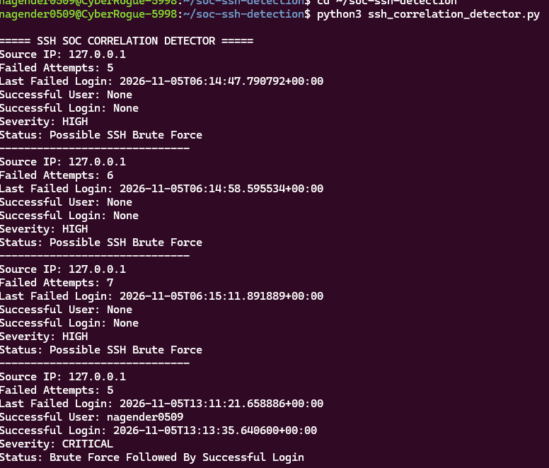
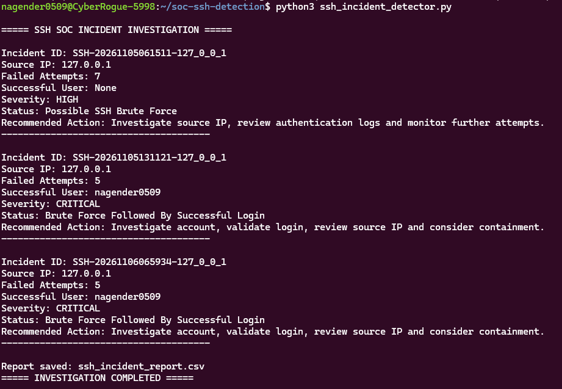

# Linux SSH Brute Force Detection and Incident Investigation System

## Project Overview

A Python-based Security Operations Center (SOC) project developed using Ubuntu WSL to detect SSH brute-force attacks, correlate failed and successful authentication attempts, and generate incident investigation reports.

The project simulates real-world SOC monitoring and incident triage activities.

## Objectives

- Detect repeated SSH authentication failures.
- Identify suspicious login patterns.
- Correlate failed login attempts with subsequent successful logins.
- Classify security events based on severity.
- Generate automated CSV security reports.
- Provide recommended incident response actions.

## Technologies Used

- Operating System: Ubuntu Linux (WSL)
- Programming Language: Python 3
- Version Control: Git and GitHub
- Log Analysis: SSH Authentication Logs
- Reporting: CSV

## Project Features

1. **SSH Brute Force Detection:** Identifies repeated failed SSH login attempts.
2. **Authentication Correlation:** Detects successful logins following multiple failed attempts.
3. **Real-Time Monitoring:** Includes an SSH monitoring script.
4. **Incident Investigation:** Generates incident IDs, severity classifications and recommended actions.
5. **Automated Reporting:** Exports detection, correlation and investigation results into CSV files.

## Project Architecture

SSH Authentication Logs  
↓  
Python Log Analysis  
↓  
Brute Force Detection  
↓  
Failed and Successful Login Correlation  
↓  
Severity Classification  
↓  
Incident Investigation  
↓  
CSV Security Reports

## Project Files

| File | Description |
|---|---|
| ssh_bruteforce_detector.py | Detects SSH brute-force attempts |
| ssh_correlation_detector.py | Correlates failed and successful logins |
| ssh_incident_detector.py | Performs incident investigation |
| ssh_realtime_monitor.py | SSH monitoring script |
| ssh_detection_report.csv | Detection report |
| ssh_correlation_report.csv | Correlation report |
| ssh_incident_report.csv | Incident investigation report |
| screenshots/ | Project evidence and screenshots |

## Detection Results

The lab testing demonstrated:

- Multiple failed SSH authentication attempts.
- HIGH severity classification for possible brute-force activity.
- CRITICAL severity classification when brute-force attempts were followed by a successful login.
- Identification of the successful login account.
- Generation of automated incident investigation reports.

## Screenshots

### SSH Brute Force Correlation Detection



### SSH Incident Investigation



## Installation and Execution

### 1. Clone the repository

```bash
git clone https://github.com/nagender-cybersec/linux-ssh-bruteforce-detection.git
```

### 2. Navigate to the project

```bash
cd linux-ssh-bruteforce-detection
```

### 3. Run the brute-force detector

```bash
python3 ssh_bruteforce_detector.py
```

### 4. Run the correlation detector

```bash
python3 ssh_correlation_detector.py
```

### 5. Run incident investigation

```bash
python3 ssh_incident_detector.py
```

### 6. Run real-time monitoring

```bash
python3 ssh_realtime_monitor.py
```

## Skills Demonstrated

- Linux fundamentals
- Python scripting
- SSH authentication log analysis
- Brute-force attack detection
- Security event correlation
- Incident investigation
- Severity classification
- SOC alert triage
- CSV report generation
- Git and GitHub

## Project Limitations

This is a learning and simulation project. Test results should be validated against the actual lab environment. The loopback IP address used in testing does not represent an external attacker.

## Author

**Nagender Thokala**

Aspiring SOC Analyst | Cybersecurity Enthusiast

GitHub: https://github.com/nagender-cybersec

---

*Developed as a hands-on SOC Analyst learning project using Python and Ubuntu WSL.*
